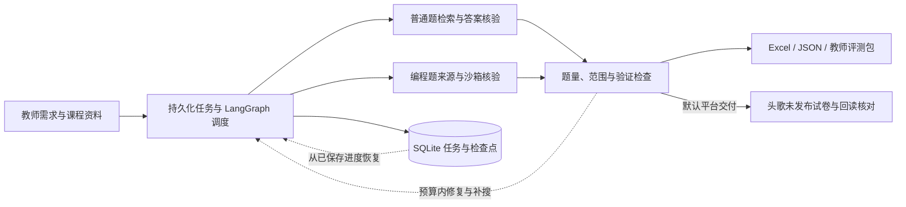
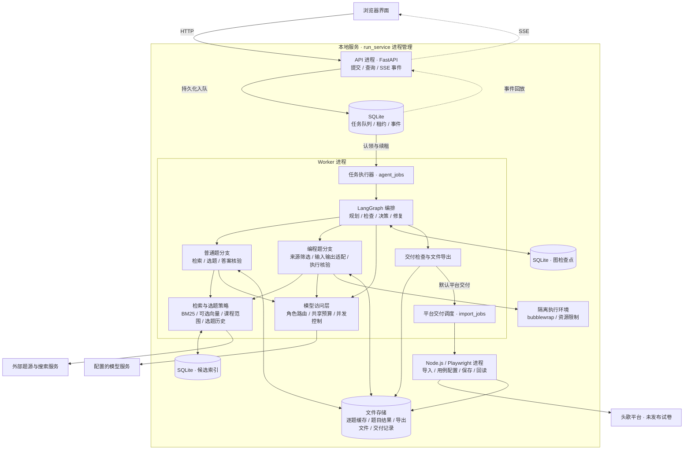

[CourseAgent](https://github.com/hilzlzl/CourseAgent) 是一个本地运行的课程作业工具，使用 LangGraph 编排搜题、答案核验和导出。输入课程范围、题型和数量后，普通题与编程题分别检索，再检查答案和参考程序，输出 Excel、JSON 和教师评测包。

默认会把结果保存到头歌的未发布试卷，并回读核对；正式发布由教师操作。也可以选择“仅本地生成”，只导出文件。

<div class="project-links"><a href="https://github.com/hilzlzl/CourseAgent" target="_blank" rel="noopener noreferrer">GitHub 源码 ↗</a><a href="https://github.com/hilzlzl/CourseAgent/blob/main/docs/quickstart.md" target="_blank" rel="noopener noreferrer">安装与使用 ↗</a><a href="/projects/#courseagent">项目概览 →</a></div>

## 输入需求

以数据结构课程为例：

> 给数据结构课程布置一次关于栈和队列的作业，包含 4 道单选题、4 道判断题和 4 道编程题，提供参考答案、公开样例与隐藏评测数据。

可以上传有文字层的 PDF 或 DOCX，作为选题范围。筛选时会参考考点、课程资料和选题历史，最终题目仍需教师审阅。

## 处理流程



图源：[CourseAgent README](https://github.com/hilzlzl/CourseAgent/blob/main/README.md)。

普通题与编程题并行搜集，随后按课程范围和选题历史筛选。普通题核对答案，编程题核对公开样例，并在 Linux 沙箱内执行参考程序、生成评测数据。题量或验证结果未满足要求时，在剩余预算内补搜和修复。

检查完成后导出文件，按所选模式决定是否保存到平台。各模块的职责见[系统架构](https://github.com/hilzlzl/CourseAgent/blob/main/docs/architecture.md)。

## 任务恢复

任务队列与 LangGraph 检查点保存在 SQLite 中，通过心跳租约管理执行中的任务。逐题缓存保存已通过的验证结果；题目内容变化后，对应凭据失效，需要重新验证。

失败阶段和已保留的结果可以在页面查看。修正配置后，可在原任务上继续执行。

## 系统架构

API 和 Worker 是独立进程，任务队列与图检查点分别存储。编程参考程序在 Linux 沙箱运行，平台导入由 Node.js / Playwright 适配器执行。



图源：[CourseAgent 系统架构](https://github.com/hilzlzl/CourseAgent/blob/main/docs/architecture.md)。

## 实验记录

实验包含 20 组需求，每组运行 3 次，共 60 次任务、876 题次。生成结果如下：

| 指标 | 结果 |
| --- | ---: |
| 题目完成 | 852/876（97.26%） |
| 整套任务完成 | 55/60（91.67%） |
| 普通题完成 | 470/474 |
| 编程题完成 | 382/402 |
| 耗时 P50 / P90 | 607 / 1,320 秒 |

这里统计的是生成完成率，题目质量与平台保存回读另行评估。样例和参考程序核验不能覆盖所有错误。实验设置与评分规则见[实验评估](https://github.com/hilzlzl/CourseAgent/blob/main/docs/evaluation.md)，公开记录见[评测数据](https://github.com/hilzlzl/CourseAgent/tree/main/evaluations)。

## 本地运行

推荐 Linux 或 Windows WSL2，Python 3.11+。先克隆仓库，再在项目目录执行：

```bash
git clone https://github.com/hilzlzl/CourseAgent.git
cd CourseAgent
python3 -m venv .venv
source .venv/bin/activate
python -m pip install -r requirements.lock.txt
python -m pip install --no-deps -e .
python -m scripts.doctor
python -m scripts.demo
bash start.sh
```

打开 `http://127.0.0.1:8765/`。固定离线演示不需要 API Key，会在 `outputs/demo/` 生成示例文件；它与网页中的真实搜题任务相互独立。锁文件是 Linux / Python 3.12 的发布依赖快照，其他环境的安装方式见[运行指南](https://github.com/hilzlzl/CourseAgent/blob/main/docs/quickstart.md)。

真实搜题前，将 `model-config.example.json` 复制为 `model-config.local.json`，配置自己的模型服务。编程执行还需要 Linux bubblewrap 与相应编译器；平台交付需要 Node.js、Chrome 和教师账号登录。只需要导出文件时，选择“仅本地生成”。

## 使用限制

平台端默认保存为**未发布试卷**，正式发布由教师完成。教师评测包包含参考答案与隐藏用例，应由教师保管。扫描 PDF、复杂公式和多答案特殊判题支持有限，最终作业仍需审阅。

项目采用 MIT 许可，当前实现、依赖和配置以 [GitHub 仓库](https://github.com/hilzlzl/CourseAgent)为准。
