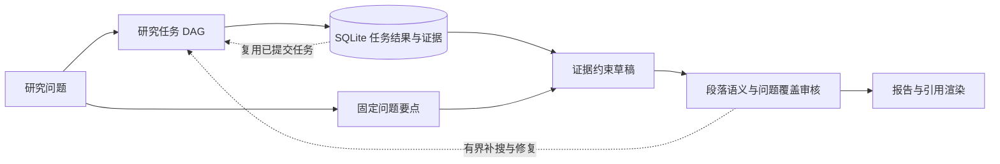
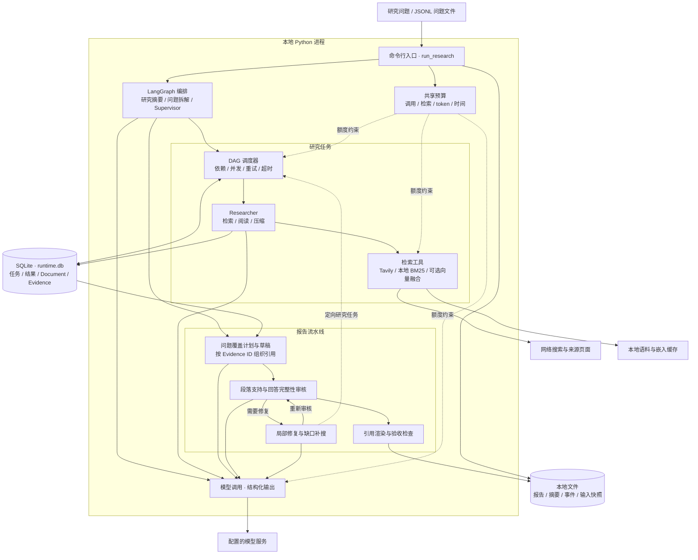

Reliable Deep Research 基于 LangChain Open Deep Research，主要增加了任务恢复和报告审核。研究任务的结果写入 SQLite，中断后可以复用已提交的结果；报告生成后，检查是否回答了问题要点，以及引用的证据是否支持对应段落。

<div class="project-links"><a href="https://github.com/hilzlzl/reliable-deep-research" target="_blank" rel="noopener noreferrer">GitHub 源码 ↗</a><a href="/projects/#reliable-deep-research">项目概览 →</a><a href="/2026/10/22/reliable-deep-research-recovery/">任务恢复设计 →</a></div>

## 与上游的区别

上游 [LangChain Open Deep Research](https://github.com/langchain-ai/open_deep_research) 提供研究编排及模型、工具集成。本项目保留这些功能，增加任务状态存储、证据管理和报告审核。

主要使用 Python、LangGraph、asyncio、Pydantic 和 SQLite，新增功能包括：

- 任务调度：以 DAG 管理依赖，持久化已完成结果，重试失败任务，清理未完成尝试留下的过期证据。
- 报告审核：读取证据前固定问题要点，再检查覆盖情况，按存储片段审核段落。
- 报告修复：保留已核实段落，按审核意见修改答案和引用，最多 2 轮修复、2 个定向补搜任务。
- 预算管理：并发任务共享模型调用、token、任务尝试和时间预算，保存验收结果与事件日志。

## 报告生成流程



图源：[reliable-deep-research README](https://github.com/hilzlzl/reliable-deep-research/blob/main/README.zh-CN.md)。

研究问题首先转成任务 DAG。检索任务产生证据，任务结果与证据进入 SQLite；报告生成环节根据固定的问题要点和这些证据编写草稿。

随后，审核环节检查段落语义支持与问题覆盖。若有缺口，系统可以在剩余预算内安排定向补搜和修复；最后由 Evidence ID 确定性渲染引用。

引用可以追溯到存储的证据片段，但段落是否得到证据支持，仍由模型判断，可能出错。

## 系统架构

调度、检索、报告和模型调用都在同一 Python 进程内。SQLite 保存任务结果与证据，本地文件保存报告、摘要和事件日志。



图源：[reliable-deep-research 系统架构](https://github.com/hilzlzl/reliable-deep-research/blob/main/docs/project_overview.zh-CN.md)。

## 开发评测

评测包含 30 道问题，每题 2 个评估槽位，共 60 个槽位，使用 24 份固定参考来源。Repository Baseline 沿用上游研究流程，并保留仓库中的检索、模型接入和预算等实验适配；Claim-first 是早期对照方案。

**Reliable Deep Research 一列为替换后开发汇总：原 47 次通过记录，加上全部 13 次重跑记录，其中仍有 1 次失败。** 60 个槽位实际经历了 73 次生成，并非在发布配置下全新运行的 60 次验收。全部原未通过槽位均被替换，未按最佳分数挑选；平均耗时与调用只计算保留的 60 个槽位，不含被替换的 13 次原始尝试开销。

| 指标 | Repository Baseline | Claim-first（早期方案） | Reliable Deep Research |
| --- | ---: | ---: | ---: |
| 验收通过 | 52/60 | 51/60 | 59/60 |
| 失败或超限 | 8 | 9 | 1 |
| 全部尝试要点覆盖 | 80.4% | 64.9% | 88.7% |
| 成功报告条件覆盖 | 93.1% | 75.7% | 90.3% |
| 抽样引用支持 | 60.9% | 96.1% | 93.6% |
| 平均耗时（秒） | 404.9 | 667.6 | 319.3 |
| 平均模型调用 | 9.52 | 19.42 | 15.25 |

覆盖分子只统计通过报告，失败计零；引用支持来自每份报告最多 5 条陈述的抽样。这里同时列出“全部尝试覆盖”和“成功报告条件覆盖”，避免忽略失败报告。

参考要点由助手编写，生成和评审使用同一网关模型别名，尚无独立人工验证。两次实验存在配置变化，且表格替换了原未通过槽位，因此只能作为开发记录，不能据此判断一般情况下的效果提升。

完整协议见[实验评测文档](https://github.com/hilzlzl/reliable-deep-research/blob/main/docs/evaluation.zh-CN.md)；全部 180 条评估样本见[公开对照记录](https://github.com/hilzlzl/reliable-deep-research/blob/main/benchmarks/results/release_comparison.json)。

## 本地演示

先从 [GitHub 仓库](https://github.com/hilzlzl/reliable-deep-research)克隆当前源码，安装 [uv](https://docs.astral.sh/uv/getting-started/installation/)，在项目根目录运行。命令适用于 PowerShell 和 Bash：

```bash
git clone https://github.com/hilzlzl/reliable-deep-research.git
cd reliable-deep-research
uv sync --frozen --python 3.11 --extra dev
uv run --frozen python -m experiments.reliability.reliability_demo
uv run --frozen --extra dev python -m pytest -q
```

演示注入一次任务失败，执行重试，再重放依赖任务并复用已经完成的检索任务。产物位于 `artifacts/reliability_demo/`，包含 `result.json`、`events.jsonl` 和 `runtime.db`。

它验证的是合成任务的执行语义，不需要模型或检索密钥。

## 运行真实研究

复制 `.env.example` 为 `.env`，填写 `OPENAI_API_KEY` 和 `TAVILY_API_KEY`，再执行：

```bash
uv run --frozen python -m experiments.runners.run_research --question "What are the failure and recovery trade-offs of durable agent workflows? Cite primary sources."
```

真实研究会产生模型与检索费用。默认上限为 40 次模型调用、4 次检索、6 次任务尝试和 1,200 秒；每道题使用独立数据库，输出报告、验收摘要和事件轨迹。退出码非零表示该次运行未通过。

自定义 API、本地检索与产物说明见[运行指南](https://github.com/hilzlzl/reliable-deep-research/blob/main/docs/running.zh-CN.md)。旧的[博客源码快照 ZIP](/downloads/reliable-deep-research.zip)继续保留，对应提交 `a4e9b4c`；最新代码请以 GitHub 为准。

## 代码位置

| 文件 | 关注的问题 |
| --- | --- |
| `task_runtime.py`、`runtime_store.py` | DAG 调度、结果事务提交、重试与重放失效处理 |
| `coverage_reporting.py`、`report_planning.py` | 问题拆解、审核、修复与证据引用渲染 |
| `run_budget.py`、`observability.py` | 共享预算与事件日志 |
| `experiments/runners/run_research.py` | 正式运行入口 |
| `tests/`、`benchmarks/` | 离线回归与数值证据 |

恢复边界是研究任务，不是整个 LangGraph 会话；外部 API 也不保证恰好执行一次。下一篇[任务恢复设计](/2026/10/22/reliable-deep-research-recovery/)进一步解释这条边界。
